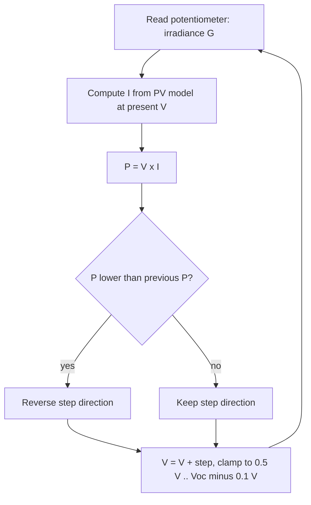

# Theory

## 1. PV panel model (single diode)

The panel is modelled as a photo-generated current source in parallel with a diode,
ignoring series and shunt resistance:

$$I = I_{ph} - I_0\left(e^{V/A} - 1\right), \qquad I_{ph} = I_{sc}\,\frac{G}{1000}$$

- $G$ is irradiance in W/m² (1000 W/m² is standard test conditions).
- $A = n\,N_s\,V_t$ lumps the diode ideality factor $n$, the number of series cells $N_s$ and
  the thermal voltage $V_t$ ($\approx 25.7$ mV at 25 °C). With $N_s = 36$, the chosen
  $A = 1.21$ V corresponds to $n \approx 1.31$.
- The saturation current follows from requiring $I = 0$ at $V = V_{oc}$ under STC:

$$I_0 = \frac{I_{sc}}{e^{V_{oc}/A} - 1}$$

- Open-circuit voltage at other irradiance levels falls out of the same equation:

$$V_{oc}(G) = A\,\ln\!\left(\frac{I_{sc}\,G/1000}{I_0} + 1\right)$$

### Parameters used

| Symbol | Value | Meaning |
|---|---|---|
| $V_{oc}$ (STC) | 22.0 V | Open-circuit voltage at 1000 W/m² (36-cell panel) |
| $I_{sc}$ (STC) | 8.0 A | Short-circuit current at 1000 W/m² |
| $A$ | 1.21 V | $n\,N_s\,V_t$ |
| $I_0$ | computed | Diode saturation current |

At STC this gives a maximum power of about 139.8 W at 18.6 V and 7.52 A, a fill factor of
$139.8 / (22 \times 8) \approx 0.79$.

## 2. Maximum power point

Power is $P = V\,I(V)$. It is zero at $V = 0$ and at $V = V_{oc}$, so there is a maximum in
between where

$$\frac{dP}{dV} = 0 \;\Longleftrightarrow\; I + V\frac{dI}{dV} = 0.$$

The location of this point moves with irradiance (and temperature), which is why a
fixed operating voltage wastes energy and a tracker is needed.

## 3. Perturb & Observe (P&O)

Every cycle the operating voltage is moved by a fixed step ($\Delta V = 0.2$ V). If power
rose compared with the previous cycle the direction is kept, otherwise it is reversed.

The code also scans the whole P–V curve (0.1 V resolution) each cycle to get the
theoretical maximum, so the tracking efficiency
$\eta_{track} = P / P_{max}$ can be displayed and logged.

### Known behaviour and limitations

- **Steady-state oscillation.** P&O never rests exactly on the peak; it circles it by about one
  step. A smaller step reduces the ripple but slows the response to changes.
- **Wrong-direction drift.** If irradiance changes quickly between two samples, the power
  change caused by the sun can be mistaken for a power change caused by the perturbation.
  Incremental Conductance and adaptive-step variants address this.
- **Model simplifications.** No series or shunt resistance, no temperature dependence, no
  partial shading (a single peak only).
- **No converter.** The operating voltage is set directly; a real system sets it through the
  duty cycle of a DC–DC converter.

## References

1. T. Esram and P. L. Chapman, "Comparison of Photovoltaic Array Maximum Power Point
   Tracking Techniques," *IEEE Transactions on Energy Conversion*, vol. 22, no. 2,
   pp. 439–449, 2007.
2. M. G. Villalva, J. R. Gazoli and E. Ruppert F., "Comprehensive Approach to Modeling and
   Simulation of Photovoltaic Arrays," *IEEE Transactions on Power Electronics*, vol. 24,
   no. 5, pp. 1198–1208, 2009.
